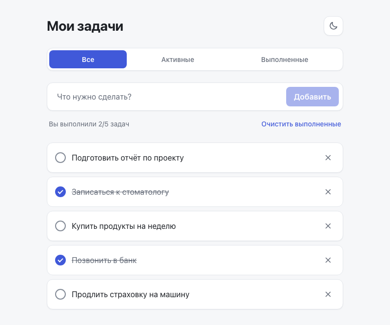

# Focus — список задач

Минималистичный список задач с фильтрами, тёмной темой и сохранением в браузере.

**Демо:** https://igorasha26.github.io/focus-todo/



## Функционал

- Добавление задачи (Enter или кнопка «Добавить»); пустое название и строка из пробелов не добавляются.
- Отметка выполнения: выполненные задачи зачёркнуты и приглушены.
- Удаление задачи и «Очистить выполненные».
- Фильтры «Все / Активные / Выполненные»; выбранный фильтр запоминается.
- Счётчик «Вы выполнили N/M задач».
- Светлая и тёмная тема: по умолчанию — как в системе, выбор сохраняется.
- Всё сохраняется после перезагрузки страницы и синхронизируется между открытыми вкладками.
- Управление с клавиатуры: фокус сразу в поле ввода, после удаления или исчезновения задачи из фильтра
  фокус переходит на соседнюю задачу, видимый фокус у всех элементов.
- Адаптивная вёрстка от 360 px, плавное появление задач (отключается при `prefers-reduced-motion`).

## Стек

- [Vite](https://vite.dev/) + [React 18](https://react.dev/) + TypeScript (strict)
- CSS Modules, тема на CSS-переменных — без UI-библиотек
- [Vitest](https://vitest.dev/) + Testing Library + jsdom — unit- и интеграционные тесты
- [Playwright](https://playwright.dev/) (Chromium) — e2e-тесты
- ESLint (typescript-eslint)
- GitHub Actions → GitHub Pages

## Запуск

Нужен Node.js 24 или новее.

```bash
npm install          # установить зависимости
npm run dev          # dev-сервер с hot reload
npm run build        # проверка типов и production-сборка в dist/
npm run preview      # локальный просмотр собранной версии
npm run lint         # ESLint
npm run test         # unit- и интеграционные тесты (Vitest)
npm run test:e2e     # e2e-тесты (Playwright)
```

## Структура проекта

```
src/
  components/   # FilterBar, TaskInput, TaskItem, TaskList, TaskSummary, ThemeToggle
                # (у каждого — Component.tsx + Component.module.css)
  hooks/        # useTasks, useFilter, useTheme — состояние и связь с хранилищем
  model/        # types.ts, tasksReducer.ts, selectors.ts — чистые функции без React
  lib/          # storage.ts — вся работа с localStorage
  styles/       # variables.css (цвета тем, отступы), global.css (reset)
  test/         # настройка тестов и вспомогательные функции
e2e/            # Playwright-тесты
index.html      # inline-скрипт, применяющий сохранённую тему до отрисовки
```

## Хранение данных

Данные хранятся в `localStorage` браузера, сервера нет. Вся работа с хранилищем — в `src/lib/storage.ts`.
